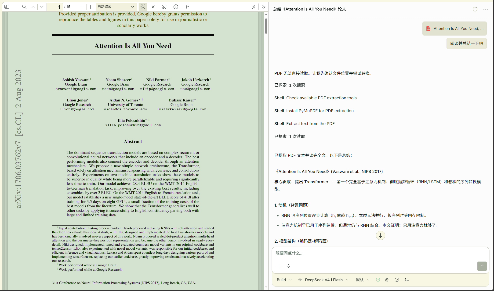
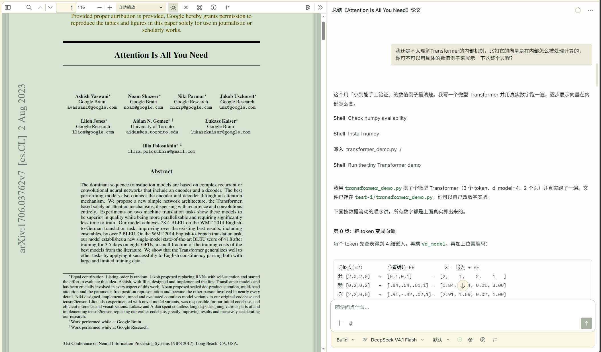
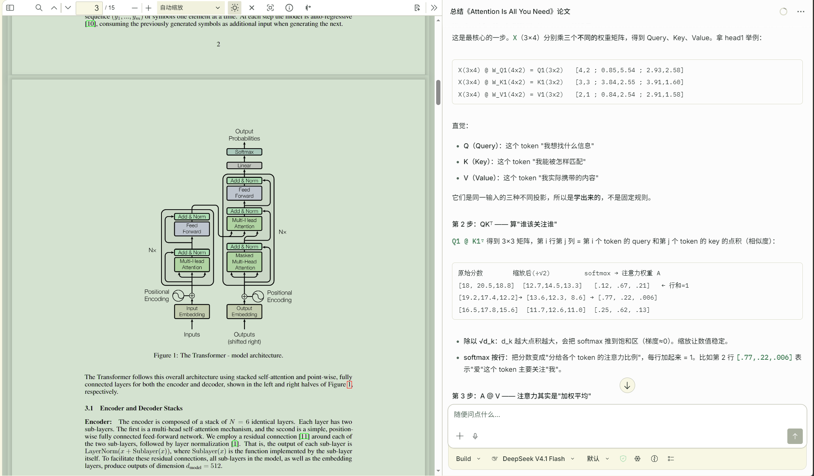
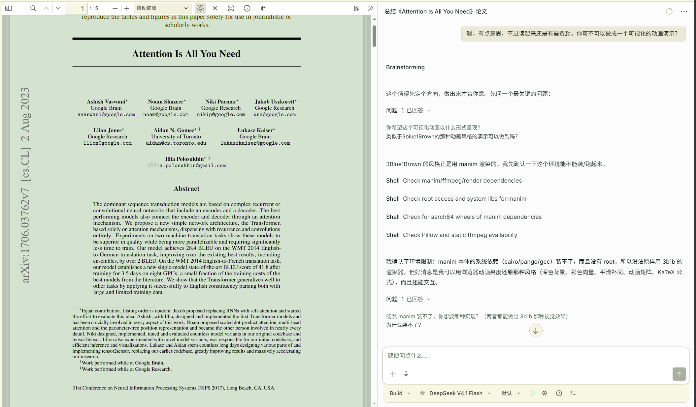
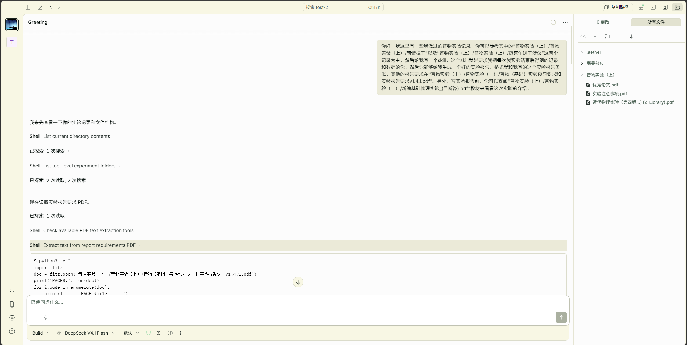
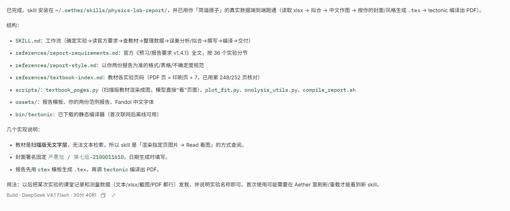
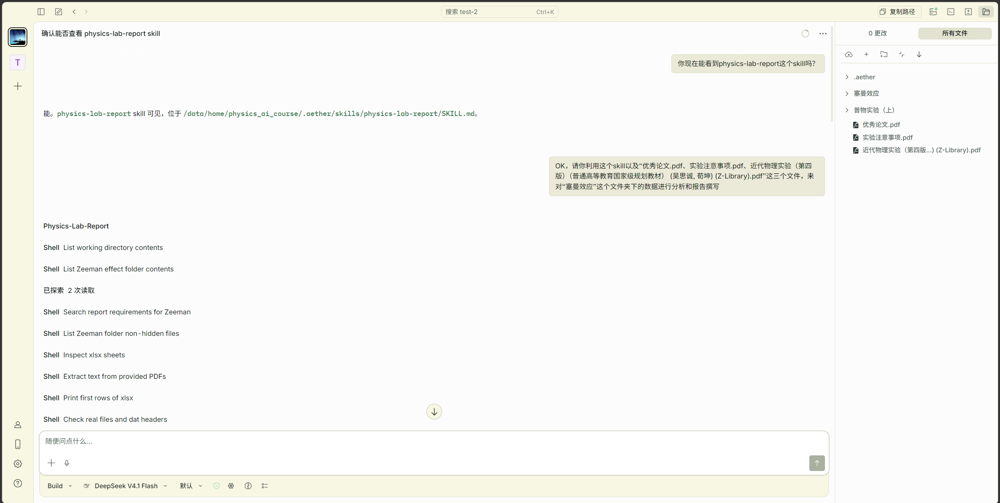

# AI 实践

这里是课堂上没来的及讲的 AI 实践体验，供同学们参考。展示先进AI Agent的强大实用价值。

## 案例一：Read with AI

我们现在让AI去阅读一篇文献，“**Attention Is All You Need**”。

这里我们看到，上传的文件，DeepSeek V4.1 flash无法直接读取，因为最新的DeepSeek 4.1 flash模型虽然是多模态的模型，可以读取各种格式的图片，但是原生的API接口并不支持直接让模型读取PDF文件。

然而，Aether框架下的DeepSeek发挥了工具调用的能力，选择调用可用的工具PyMuPDF，一个Python包，来将PDF文件转为文字，并进行读取。

随着阅读的进行，我们发现自己可能看不太懂一些技术细节，于是我们让AI来举例讲解，可以看到DeepSeek确实非常理解本文的Transformer架构，并真的通过具体的一个输入的例子，通过非常详细的计算和讨论，来给我们讲解。

然而，尽管DeepSeek给我们做了非常详细的介绍，我们也大致理解了Transformer的注意力机制是怎么样的，但是我们还是觉得这个AI的内部操作过程不是很直观，于是“愚蠢的人类”向“万能的DeepSeek”许了下一个愿——**请你实现可视化Transformer架构的计算演示。**

然后，这个就是DeepSeek给出的结果（用时半小时，开销大概0.5RMB）：

<video controls playsinline preload="metadata" aria-label="Transformer 架构计算演示" style="display: block; width: 100%; height: auto; border-radius: 8px;">
  <source src="/materials/2026-fall/ai-practice/transformer.mp4" type="video/mp4" />
  您的浏览器不支持内嵌视频，请使用下方链接下载观看。
</video>

<a href="/materials/2026-fall/ai-practice/transformer.mp4" download>下载 Transformer 演示视频（MP4）</a>

### 第二个 Transformer 可视化视频

这是另外一次测试时生成的，效果也很不错：

<video controls playsinline preload="metadata" aria-label="另一个 Transformer 演示视频" style="display: block; width: 100%; height: auto; border-radius: 8px;">
  <source src="/materials/2026-fall/ai-practice/Transformer_test_2.mp4" type="video/mp4" />
  您的浏览器不支持内嵌视频，请使用下方链接下载观看。
</video>

<a href="/materials/2026-fall/ai-practice/Transformer_test_2.mp4" download>下载第二个 Transformer 演示视频（MP4）</a>

## 案例二：Use skills

在这里我们在Aether中，非常简单地尝试去建立、使用一个skill。

作为举例，我们这是在尝试去建立一个帮助我们自动分析实验结果、撰写实验报告的skill，而skill的建立在这里也是非常的简单，仅仅是三句话，而且其中不少是在描述“文件路径”的内容。

**主要是说明了：**

- **处理对象**：实验数据和实验记录
- **skill目标**：生成好的、符合格式的实验报告
- **已有样例**：“迈克尔逊干涉仪”和“简谐振子”实验报告
- **可参考材料**：“实验报告要求”、“实验预习要求”、普物实验教科书

当然，从零创建一个skill也不是一件轻松的活，DeepSeek总共用了半小时（也是差不多五毛钱）才完成整个skill的构建。

然后我们新开一个对话，来测试我们这个非常简单就创建出来的skill的效果，第一句话是在确认一下新建skill已经被加载（因为新建的skill有时不一定会被AI扫描到，可能需要重启应用才能加载），第二句话发起任务。

**提供了：**

- **处理对象**：塞曼效应实验数据
- **可参考材料**：“实验注意事项”、“优秀论文”、近物实验教科书

这是最终得到的实验报告：

<a href="/materials/2026-fall/ai-practice/塞曼效应.pdf" target="_blank" rel="noopener noreferrer">查看实验报告：塞曼效应（PDF）</a>

<a href="/materials/2026-fall/ai-practice/塞曼效应.pdf" download>下载实验报告（PDF）</a>

## 其他

> 需要说明的是，我们这里的skill创建是非常简化的。

通常我们创建skill的情景是在面对一个我们需要经常性使用的“流程”的时候，例如某类实验数据的分析，或者某个项目的流程化操作。

对于这些每一个环节都基本明确的流程化的行为，我们想让AI来代替我们执行这些重复的工作，于是就有了skill。

比起硬编码的程序，skill的**灵活性和变通性更强**，而且构建负担也更小。

1. 一般构建一个skill，我们只要按部就班的，把我们要做的每一个环节，**一步一步地指示AI，教会AI以你的标准去执行这个环节。**

   最后在一切执行完成之后——

   > “好了，现在你已经是一个成熟的AI了，应该学会自己完成这个流程了”

2. 你调用了“**skill-creator**”这个skill，再次要求你的AI，根据你前面引导其完成的流程，来构建一个用于实现该工作流的skill。

3. 大功告成，接下来你再次遇到这个工作，就**直接调用这个skill**，让AI去做即可。

当然，这只是一种常见的skill构建流程，你也可以直接写一个说明文档，包括每一个环节应该有的产出给AI，然后让他一次性生成一个skill。

skill的构建本身并没有固定的规矩，它就像AI自身一样灵活，你可以自己发挥，**关键是你能把握好工作流的关键环节，并用提示词将你的理解传递给AI。**

所以，还是要多多使用AI，体会和AI交互的特点，并且学会写好的提示词（**不一定要长，核心是表达清楚**）。

> 随着AI能力的不断增强，AI可能会越来越接近于“许愿机”，对于以前很多对话才能完成的任务，当前的AI一句话就能做好。

但是，即便是福尔摩斯也不能在不接触案发现场、被害人、目击证人、嫌疑人的情况下破案，所以**把信息精确、高效地传达给AI**，是需要我们在不断的实践中培养的能力。
