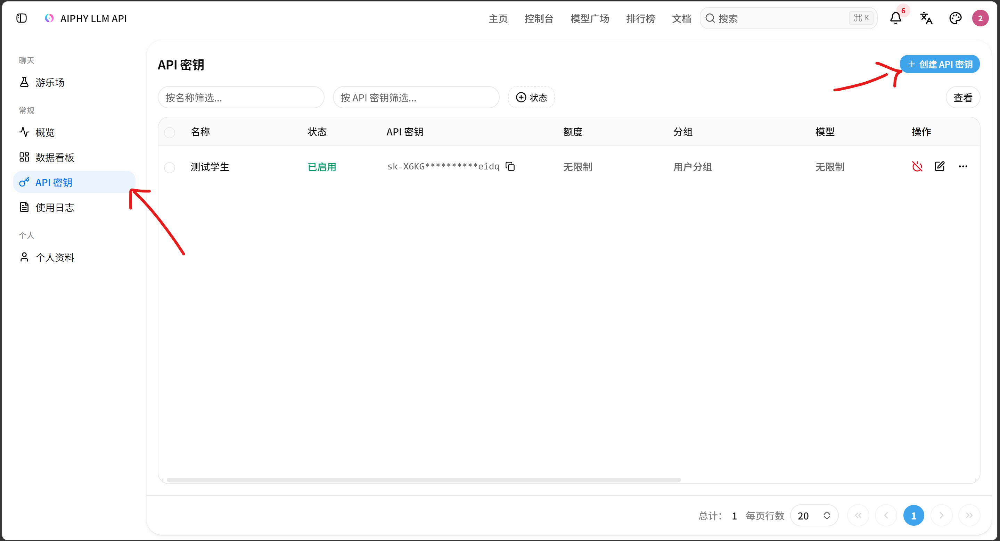
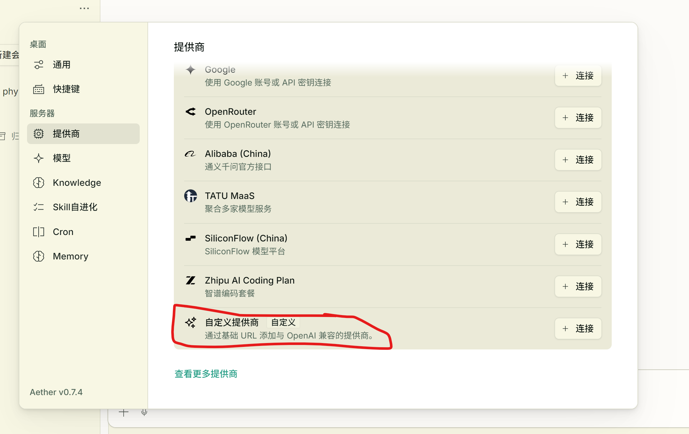
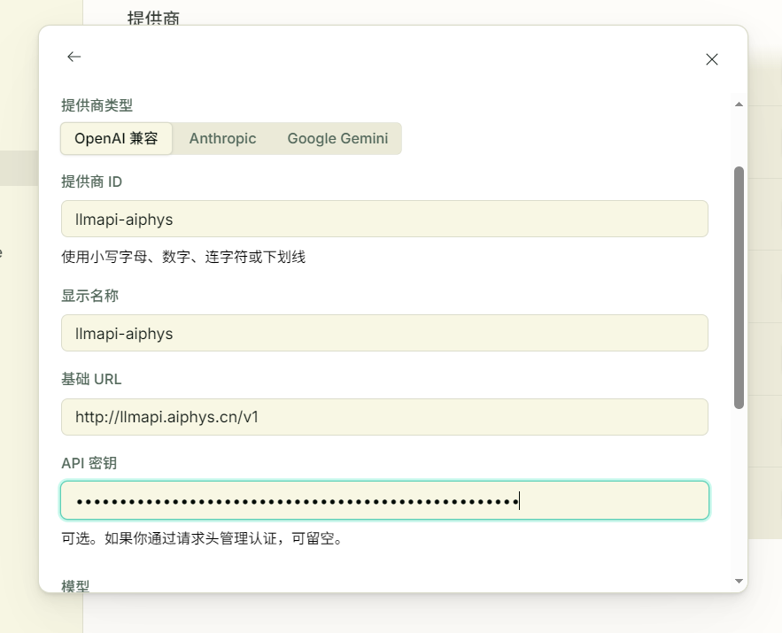
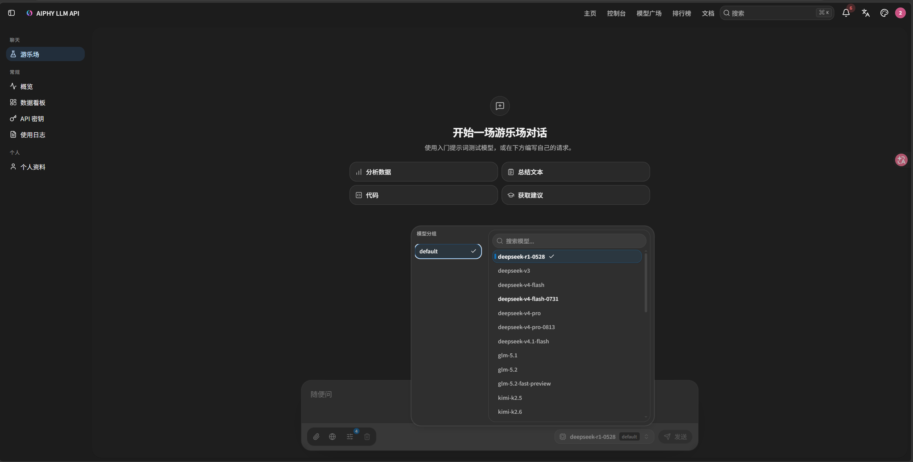
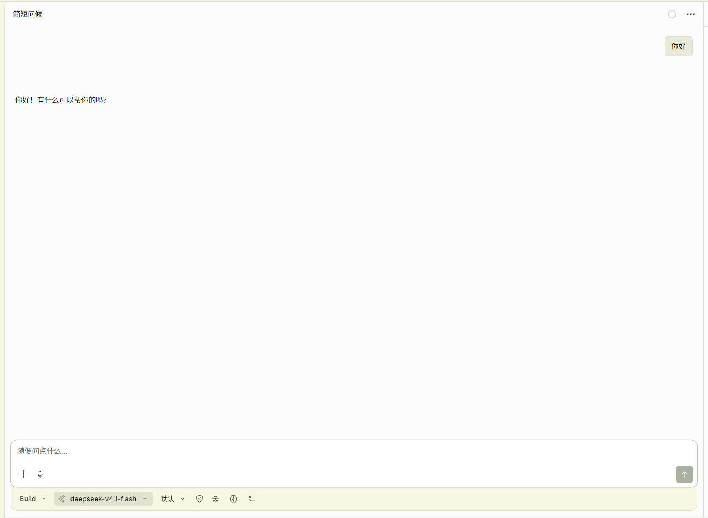

# LLM 网关（2026 秋）

课程网关用于学术研究与课程实践。

网站：http://llmapi.aiphys.cn/

账号由助教统一通过邮箱发放，每人初始有10$的额度。

如果新选课的同学没有拿到账号的可以联系助教。

## API 使用

想要创建API-Key按下图选择即可，然后自己在弹出的侧栏设置一下相关参数即可。

## API-Key在Aether上的使用

这个可能是一些同学在使用API-Key的时候会遇到的问题。

按照上面的方法获得API-Key之后，打开Aether，在“设置”中，点击“提供商”，找到“自定义提供商”（因为服务是通过我们网关提供的，而不是特定的提供商）。

点击“连接”之后，在弹出的窗口中依次填入对应的内容，其中，“提供商类型”基本不用改，大部分模型都是“OpenAI”接口的，“提供商名称”和“显示名称”随意，只要前者不和已有提供商重复就可以。基础URL就填网站然后末尾加“v1”，“http://llmapi.aiphys.cn/v1”。

然后下面的模型名称两个都填一样的就可以，主要是模型名称必须要和我们网关上的模型名称一致，具体的可以在“Playground”看模型名称：

然后就可以在Aether中对话了：

同学们自己获取的其他提供商的API-Key的使用就更方便一些，大多数情况下只要把API-Key直接填进去就可以，URL不用填。