# 服务器使用指南

2026 秋学期的课程服务器采用 **SSH 公钥登录**。请先在自己的电脑上查找已有 SSH 密钥，没有可用密钥时再创建，然后通过课程网站验证学校邮箱并上传 `.pub` 公钥；页面显示“已导入”后，再连接分配给你的服务器。当前已向选课名单中的同学开放，并启用首次提交和换钥的自动导入。

**操作顺序：查找已有密钥（没有再创建） → 验证学校邮箱 → 上传公钥 → 确认已导入 → SSH 登录 → VS Code 远程开发。**

[进入公钥上传页面](https://aiphy.pku.edu.cn/course/ssh-keys) · [查看公钥提交与状态说明](https://aiphy.pku.edu.cn/course/ssh-keys-guide)

## 1. 准备电脑和网络

- 使用自己的电脑。Windows 打开 **PowerShell**；macOS、Linux 打开“终端”。下面生成密钥和编辑 SSH 配置的步骤都在本地进行。
- 连接服务器时需要校园网，或能够访问校内网络的学校 VPN。公钥上传网页能够打开，并不一定说明 SSH 网络已经连通。
- 在终端运行 `ssh -V` 检查 SSH 客户端。如果提示找不到命令，Windows 可在系统“可选功能”中安装 OpenSSH 客户端；macOS、Linux 通常已提供，未安装时请按本机系统配置或联系助教。

## 2. 准备 SSH 密钥

### 先查找已有密钥

先在自己的电脑上找一下是否已经有 SSH 密钥。密钥通常保存在：

- **Windows**：`C:\Users\你的电脑用户名\.ssh\`
- **macOS / Linux**：`~/.ssh/`

::: tip 找不到 `.ssh` 文件夹或 `.pub` 文件
Windows 可以在文件资源管理器或文件选择窗口的地址栏输入 `%USERPROFILE%\.ssh`；macOS 可以在访达或文件选择窗口按 `Command + Shift + G` 后输入 `~/.ssh`；Linux 可在文件管理器或文件选择器中显示隐藏文件。如果 `.ssh` 目录不存在，或其中没有可用的密钥，再按下面的步骤创建。
:::

查找成对的文件，例如 `id_ed25519` 和 `id_ed25519.pub`，或 `id_rsa` 和 `id_rsa.pub`。带 `.pub` 后缀的是公钥，可以上传；对应的不带 `.pub` 后缀的文件是私钥，留在自己的电脑上。

**如果已有 Ed25519 公钥，或至少 3072 位的 RSA 公钥，并且本机保留着对应的私钥，就可以直接使用，无需重新生成。** 记住这两个文件的位置，直接继续第 3 步上传公钥；后面配置 `IdentityFile` 时，填写对应私钥的实际路径。

### 没有可用密钥时再创建

如果没有符合要求的密钥，再按以下步骤生成。推荐使用 Ed25519，下面使用文件名 `id_ed25519_course`，便于识别课程使用的密钥。

::: warning 已有同名文件时不要覆盖
如果命令提示 `already exists` 或询问 `Overwrite (y/n)?`，先输入 `n`。确认现有密钥是否可以继续使用；也可以选择另一个文件名，并在后面的配置中使用相同名字。
:::

#### Windows：在 PowerShell 中运行

```powershell
New-Item -ItemType Directory -Force "$HOME\.ssh" | Out-Null
ssh-keygen -t ed25519 -f "$HOME\.ssh\id_ed25519_course" -C "course-ssh"
```

#### macOS / Linux：在终端中运行

```sh
mkdir -p ~/.ssh
ssh-keygen -t ed25519 -f ~/.ssh/id_ed25519_course -C "course-ssh"
```

**一般可以不设置本地私钥的保护口令。** 出现 `Enter passphrase (empty for no passphrase):` 时直接回车，随后在 `Enter same passphrase again:` 提示下再次回车，即可跳过口令设置。

如果选择设置口令，它用于解锁本机私钥，**不是学校邮箱密码，也不是服务器登录密码**；输入时不会显示字符。

生成后会得到两个文件，保存在上面说明的 `.ssh` 目录中：

| 文件 | 用途 | 是否上传 |
| --- | --- | --- |
| `id_ed25519_course` | 私钥，登录时由本机 SSH 客户端使用 | **不上传，留在自己的电脑上** |
| `id_ed25519_course.pub` | 公钥，登记到课程服务器 | 上传这一份 |

## 3. 在网站验证邮箱并上传公钥

1. 打开[公钥上传页面](https://aiphy.pku.edu.cn/course/ssh-keys)，输入自己的**完整学号**，保留开头的零，不加 `stu`。
2. 点击“发送验证码”。邮件发送到 `学号@stu.pku.edu.cn`；在十分钟内填写收到的六位验证码并登录。网站不需要你的邮箱密码。
3. 登录后核对页面显示的姓名、服务器号和 Linux 用户名。
4. 选择上一步找到或新建的 `.pub` 公钥文件，例如 `id_ed25519.pub`、`id_rsa.pub` 或 `id_ed25519_course.pub`，点击“提交公钥”。一份文件只能包含一把公钥，最大 4 KiB。
5. 保持页面打开，等待状态自动更新为 **“已导入”**。也可点击“刷新状态”。

“已收到有效公钥”表示网站已保存提交；**“已导入”才表示服务器已完成公钥写入和核验**。正常情况下会自动处理，若显示以下状态，请按提示操作：

| 状态 | 你需要做什么 |
| --- | --- |
| 等待自动导入 / 等待导入 / 正在导入 | 稍等并查看自动更新，无需重复上传 |
| 账号不存在，待创建 / 待管理员授权 | 联系助教准备账号；等待中的自动任务会再次检查，无需重传 |
| 待助教审核 | 等待助教确认；可能是自动导入暂时关闭或此前保存的提交 |
| 导入失败 / 自动导入受阻、暂停或取消 | 把页面显示的原因发给助教处理 |
| 已导入 | 继续下面的 SSH 登录步骤 |

## 4. 确认分配服务器和用户名

以公钥上传页面显示的分配信息为准，只连接分配给自己的服务器。

| 页面服务器号 | SSH 地址 | SSH 端口 |
| --- | --- | --- |
| 132 | `162.105.151.132` | `2024` |
| 190 | `162.105.151.190` | `2024` |
| 197 | `162.105.151.197` | `2024` |

Linux 用户名是 **`stu` 加完整学号**。例如，示例学号 `2000000000` 对应用户名 `stu2000000000`；学校邮箱仍是 `2000000000@stu.pku.edu.cn`，邮箱前面不加 `stu`。

## 5. 配置并使用 SSH 登录

下面的操作都在**自己的电脑上**进行。SSH 配置保存在本地 `.ssh` 目录中，文件名为 **`config`**，没有扩展名。

### 创建或打开 `config` 文件

#### Windows：用 PowerShell 和记事本

打开 PowerShell，复制并运行下面这段命令：

```powershell
New-Item -ItemType Directory -Force "$HOME\.ssh" | Out-Null
if (-not (Test-Path -LiteralPath "$HOME\.ssh\config")) {
    New-Item -ItemType File -Path "$HOME\.ssh\config" | Out-Null
}
notepad "$HOME\.ssh\config"
```

这会在需要时创建 `.ssh` 文件夹和名为 `config` 的空文件，再用记事本打开。如果文件已经存在，就打开它继续编辑，原有内容会保留。文件的完整路径是 `C:\Users\你的电脑用户名\.ssh\config`。

#### macOS / Linux：用终端编辑

打开本地终端，依次运行：

```sh
mkdir -p ~/.ssh
touch ~/.ssh/config
chmod 600 ~/.ssh/config
nano ~/.ssh/config
```

这会创建或打开 `~/.ssh/config`，已有文件的内容会保留。最后一条命令使用终端中的 Nano 编辑器打开它。

### 填写并保存配置

把下面的配置复制到刚打开的文件中，再替换为自己的信息。如果文件已有内容，保留原配置，将新增的这一段放在已有 `Host *` 等通配配置之前，以免已有默认值优先生效。

下面以**分配到 190 服务器**的示例账号为例。请把 `HostName` 改成上表中你的服务器地址，把 `User` 改成自己的 `stu学号`，把 `IdentityFile` 改成所用私钥的实际路径：

```sshconfig
Host course-server
    HostName 162.105.151.190
    User stu2000000000
    Port 2024
    IdentityFile ~/.ssh/id_ed25519_course
    IdentitiesOnly yes
```

`IdentityFile` 指向本地**私钥**，不能填 `.pub` 文件。如果复用已有密钥，例如上传的是 `id_ed25519.pub`，这里就改为对应的 `~/.ssh/id_ed25519`；如果密钥保存在其他位置，则填写它的实际路径。

`course-server` 是这段配置的别名；若本机已有同名 `Host`，请换一个未使用的名字。Windows 的 OpenSSH 配置同样支持这里的 `~/.ssh/` 路径。

填写完成后保存文件：

- **Windows 记事本**：按 `Ctrl + S` 保存即可。这里已经创建了正确的 `config` 文件，不需要“另存为”，也不要改成 `config.txt`。
- **macOS / Linux 的 Nano**：按 `Ctrl + O`，再按回车确认文件名；随后按 `Ctrl + X` 退出。macOS 这里也使用 `Control` 键，不是 `Command` 键。

### 连接服务器

保存后，在本地 PowerShell 或终端运行：

```sh
ssh course-server
```

第一次连接时，如果出现 `Are you sure you want to continue connecting (yes/no/[fingerprint])?`，输入 `yes` 并回车，继续连接。

如果以后出现 `REMOTE HOST IDENTIFICATION HAS CHANGED`，请联系助教处理。

如果出现 `Enter passphrase for key ...`，输入生成密钥时设置的**本地私钥口令**；未设置口令的私钥不会出现这一提示。课程账号使用公钥认证，无需输入学号作为服务器密码。

连接成功后，可以运行以下命令确认自己已经进入服务器：

```sh
whoami
hostname
pwd
```

`whoami` 应显示自己的 `stu学号`。此时终端中运行的命令发生在服务器上；输入 `exit` 可退出并返回本地电脑。

## 6. 使用服务器上的 Conda 环境

132、190、197 三台服务器均已安装公共 Conda，路径为 `/opt/miniconda`，并提供 `pubpy` 环境。下面的命令都在**登录后的服务器终端**中执行，VS Code 的远端终端也适用。

### 首次登录：让 Bash 识别 Conda

如果运行 `conda env list` 提示找不到 `conda`，或首次使用尚未初始化，可以依次执行：

```bash
eval "$(/opt/miniconda/bin/conda shell.bash hook)"
conda init bash
```

第一条让当前 Bash 会话可以使用 `conda activate`；第二条将初始化配置写入你自己的 `~/.bashrc`，之后重新连接或新开 Bash 终端即可自动加载 Conda，无需每次重复初始化。

命令行前可能出现 `(base)`，表示当前激活了基础环境；是否自动显示 `(base)` 取决于配置。可以用下面的命令检查已有环境，不必只根据提示符判断：

```bash
conda env list
```

### 进入课程公共环境

列表中的 `pubpy` 对应 `/opt/miniconda/envs/pubpy`。运行：

```bash
conda activate pubpy
```

通常会看到提示符前的环境名变成 `(pubpy)`。可以进一步确认当前 Python：

```bash
python -c "import sys; print(sys.executable)"
```

使用公共环境时，应输出 `/opt/miniconda/envs/pubpy/bin/python`。该环境已准备课程使用的 Python 依赖；具体库和版本以本学期课程要求为准。公共环境由管理员维护，需要增补或调整依赖时请联系助教。

### 退出环境或服务器

退出当前 Conda 环境：

```bash
conda deactivate
```

它只退出当前环境，不会断开 SSH。完成工作后，输入以下命令退出服务器：

```bash
exit
```

初始化完成不代表以后每次都自动进入 `pubpy`；在新的工作终端中使用课程环境前，仍可运行 `conda activate pubpy`。在 VS Code 中还需为 Python 文件选择解释器、为 Notebook 选择内核，下面的图文步骤会说明。

## 7. VS Code + Remote - SSH 连接服务器

完成前面的 SSH 配置和 Conda 初始化后，可以在自己的电脑上使用 VS Code 编辑服务器上的文件、运行 Python 程序和 Jupyter Notebook。请先确认本地终端运行 `ssh course-server` 能成功登录，公钥提交页面已显示“已导入”。

::: tip 截图中的名称与输出仅作示例
下面保留了原教程的完整操作截图。部分截图中的服务器别名、用户名或界面样式可能与现在不同：连接时请选择自己配置的 `course-server`，服务器用户名使用 `stu学号`，Python 解释器和 Notebook 内核选择 `pubpy`。截图中的程序输出也只是示例，以当前服务器环境和实际运行结果为准。
:::

### 1. 安装 VS Code 和 Remote - SSH

在自己的电脑上打开 [Visual Studio Code 官网](https://code.visualstudio.com/)，根据操作系统下载并安装 VS Code。

打开 VS Code，点击左侧的“扩展”按钮，搜索并安装 Microsoft 发布的 **Remote - SSH** 扩展。如果希望使用中文界面，还可以搜索并安装 **Chinese (Simplified) Language Pack for Visual Studio Code**，然后按提示重启 VS Code。

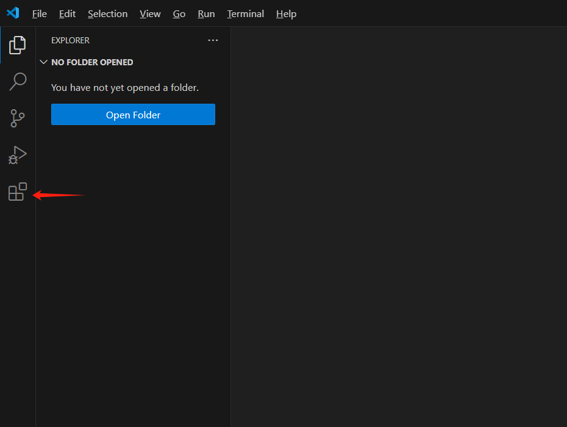
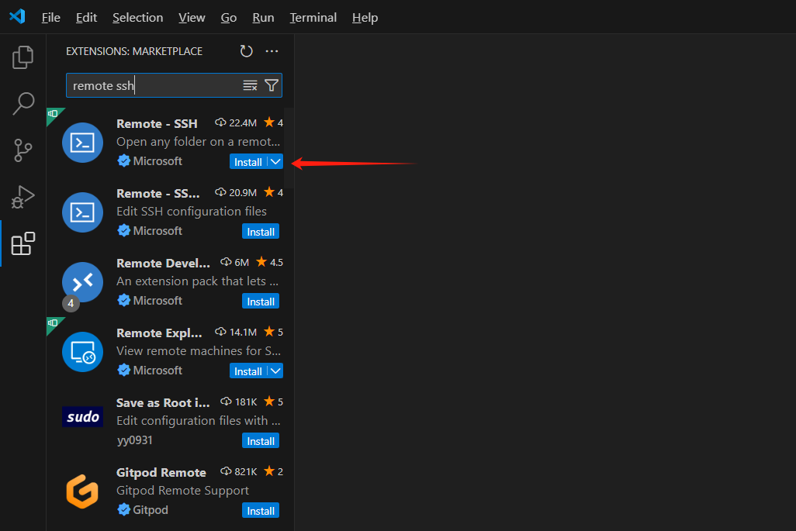
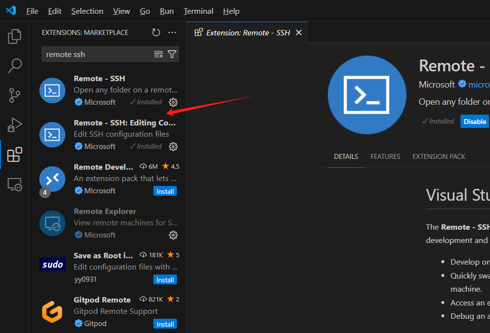
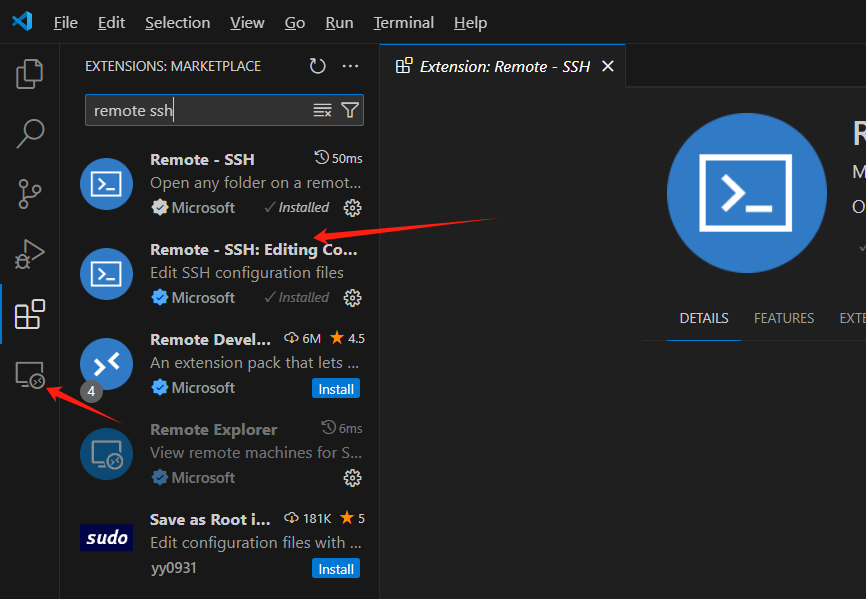

### 2. 连接课程服务器

安装完成后，点击左侧的“远程资源管理器”图标，可以看到已写入本地 SSH `config` 文件的服务器别名。找到 `course-server`，将光标悬停在名称上，点击连接箭头；如果要求选择远端操作系统，选择 **Linux**。

也可以按 `Ctrl + Shift + P`（macOS 为 `Command + Shift + P`），执行 **Remote-SSH: Connect to Host...**，然后选择 `course-server`。

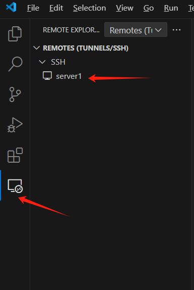
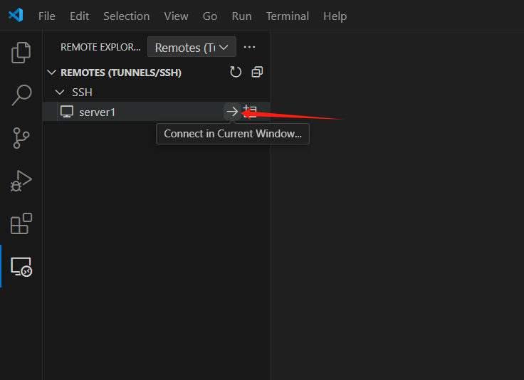
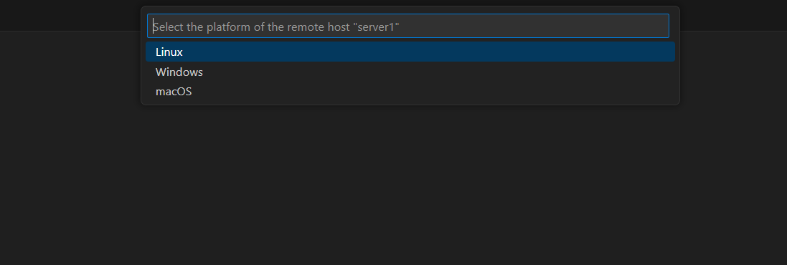

课程账号通过公钥认证，VS Code 使用前面 `IdentityFile` 配置指定的本地私钥。如果生成私钥时设置了保护口令，需要输入该口令；没有设置口令则不需要输入。不要把学号或邮箱密码当作服务器登录密码输入。

首次连接时，VS Code 会在服务器端准备 VS Code Server，可能需要等待一段时间。完成后，左下角应显示 `SSH: course-server`，表示当前窗口已连接到课程服务器。

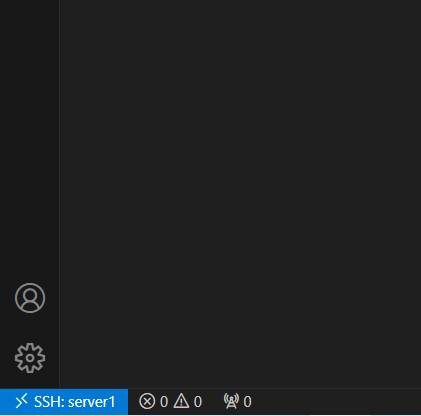

### 3. 在远端安装 Python 开发扩展

保持连接到 `course-server`，再次打开“扩展”，搜索并安装 Microsoft 发布的 **Python**、**Pylance** 和 **Jupyter** 扩展。如果这些扩展已经安装在本地，但仍显示“在 SSH: course-server 中安装”，请点击该按钮完成远端安装。

这些扩展需要访问远端的 Python 环境和代码，因此仅在本地安装还不够。安装完成后，确认它们在当前 SSH 远端窗口中可用。

### 4. 打开远端终端和工作文件夹

在菜单栏选择“终端 → 新建终端”。在这个远端窗口中打开的终端运行在课程服务器上，与前面通过 SSH 登录后的终端一致。

在自己的主目录下创建一个练习文件夹：

```bash
cd ~
mkdir -p test
```

然后选择“文件 → 打开文件夹”，打开刚创建的 `~/test`。如果提示是否信任该文件夹，确认这是自己创建的练习目录后再选择信任。

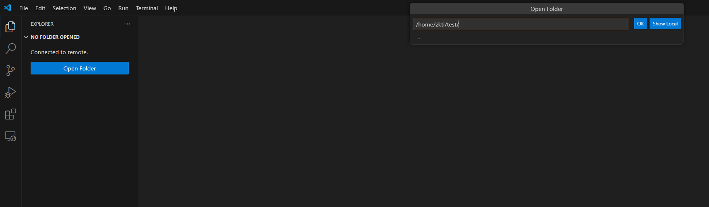

### 5. 选择 Python 解释器并运行程序

在左侧资源管理器点击“新建文件”，创建 `hello_world.py`。

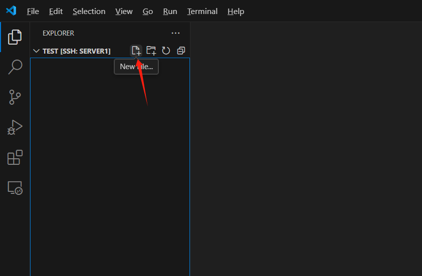
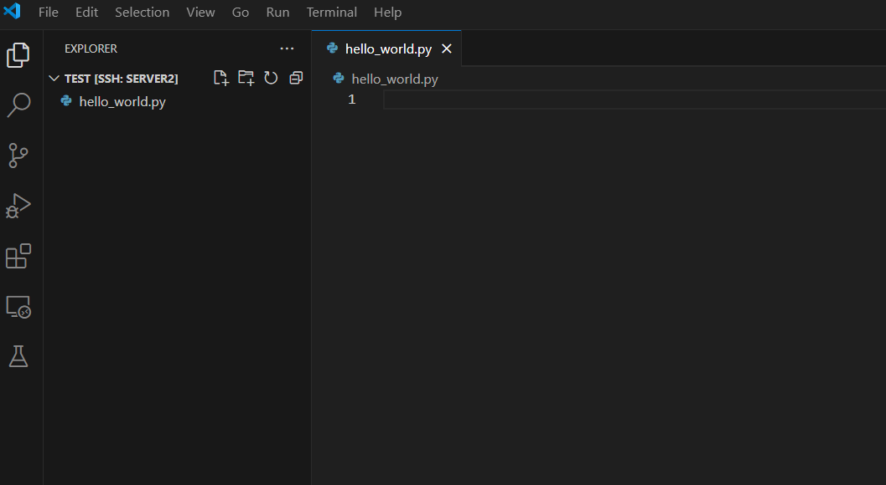

打开这个 `.py` 文件，在界面右下角点击 Python 解释器名称，选择 **pubpy**。如果没有看到解释器入口，也可以打开命令面板，执行 **Python: Select Interpreter**。若列表中暂时没有 `pubpy`，选择输入解释器路径，并填写：

```text
/opt/miniconda/envs/pubpy/bin/python
```

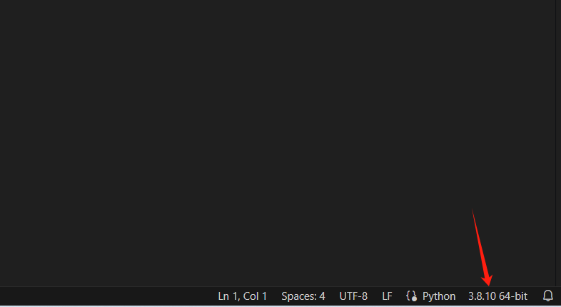
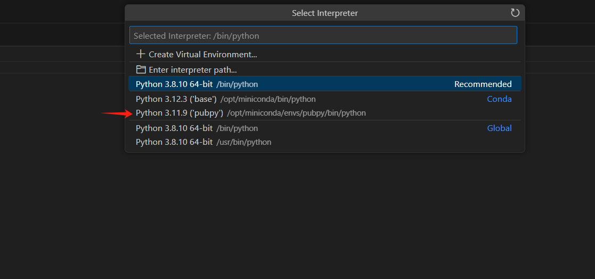
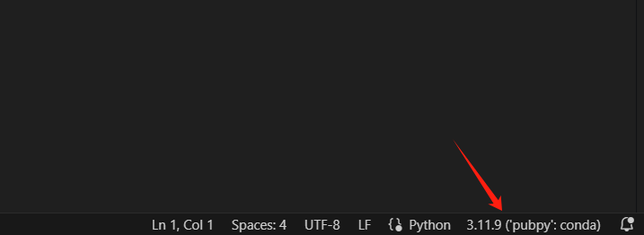

在 `hello_world.py` 中输入并保存：

```python
import numpy as np

print("Hello World!")
```

在远端终端中激活 `pubpy`，并运行程序：

```bash
conda activate pubpy
python hello_world.py
```

终端应显示 `Hello World!`。如果 `conda` 尚未初始化，请先按前面的 Conda 说明完成初始化，再打开一个新终端。选择 VS Code 的解释器与激活已有终端中的 Conda 环境是两个操作；运行前确认当前终端使用的是 `pubpy`。

也可以点击编辑器右上角的 **Run Python File in Terminal／在终端中运行 Python 文件** 按钮，在下方终端查看输出。有关 Python 开发环境的更多说明，见[开发环境](./development)。

下面的 PyTorch 检查是选做内容；只有当前 `pubpy` 环境已安装 `torch` 时才能运行。输出取决于服务器上的 PyTorch、GPU 和驱动配置，截图结果不代表你运行时一定得到相同结果。如提示缺少 `torch`，先联系助教确认课程环境安排，不要自行修改共享环境。

```python
import torch

print(torch.cuda.is_available())
print("Hello, world!")
```

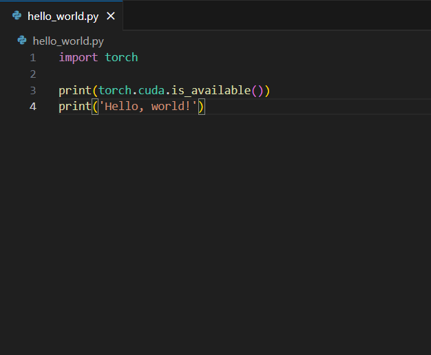
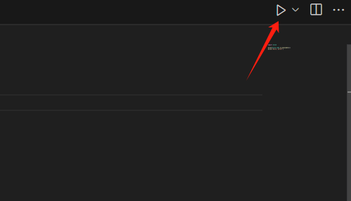
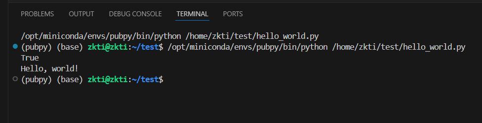

### 6. 运行 Jupyter Notebook

在左侧资源管理器新建 `hello_world.ipynb`，打开这个 Notebook 文件。

点击右上角的“选择内核”，根据界面提示进入“Python 环境”，选择 **pubpy**。Notebook 的内核需要单独选择，不会仅因为 `.py` 文件已选过解释器就自动保证一致。若 `pubpy` 不在列表中，先确认远端的 Python 和 Jupyter 扩展已安装，并核对上面的解释器路径。

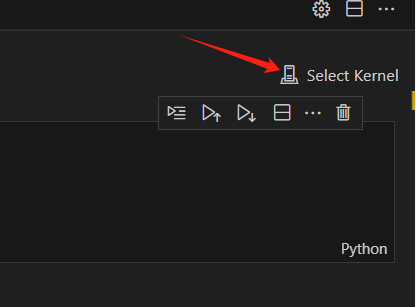
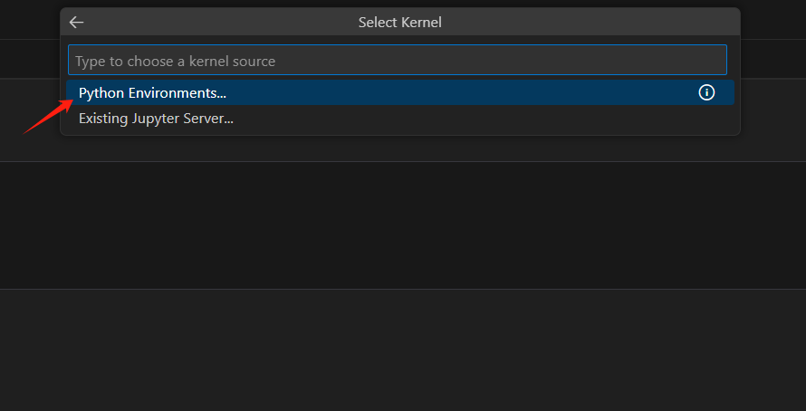
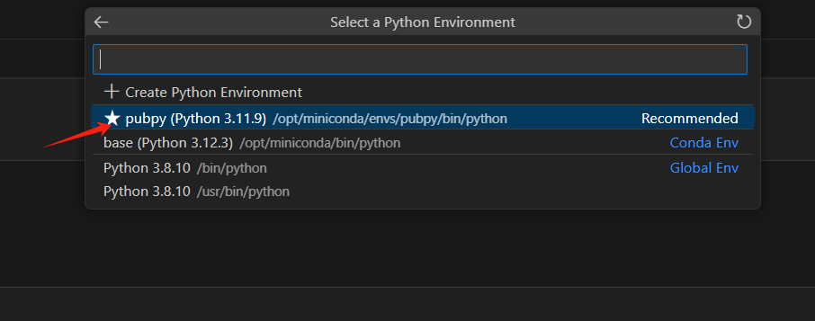

在已有代码单元格（cell）中，或点击“+ 代码”新建一个单元格，输入前面的示例：

```python
import numpy as np

print("Hello World!")
```

点击单元格左侧的运行按钮，或按 `Shift + Enter`，即可在单元格下方看到输出。需要运行其他示例时，同样先确认当前内核为 `pubpy`；如果界面提示该共享环境缺少运行 Notebook 所需的组件，请联系助教处理。

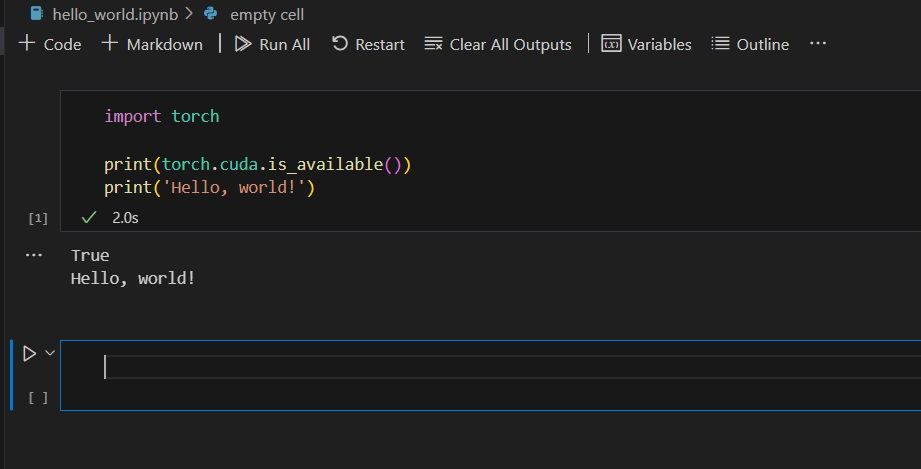

服务器是共享资源，请在自己的目录下保存代码和数据，按课程要求使用计算资源。

## 8. 常见问题

| 问题 | 检查方法 |
| --- | --- |
| 收不到验证码 | 确认输入的是完整学号、打开的是 `学号@stu.pku.edu.cn` 邮箱，并检查垃圾邮件；仍未收到请联系助教核对名单 |
| 提示不是有效公钥 | 选择真正的 `.pub` 文件；不要给私钥改后缀；确认是一把 Ed25519 或至少 3072 位 RSA 公钥 |
| `Connection timed out` / 无法连接 | 检查校园网或校内 VPN、分配的 IP 和端口 `2024` |
| `Permission denied (publickey)` | 确认页面已显示“已导入”；检查 `stu学号`、分配服务器，以及 `IdentityFile` 是否是所上传公钥对应的私钥 |
| 提示找不到 identity file | 检查私钥实际保存位置和文件名；不要把 Windows PowerShell 的 `$HOME` 写进 SSH `config`，配置中用 `~/.ssh/...` |
| 要求输入 `passphrase` | 输入生成密钥时设置的本地私钥口令，不是邮箱密码或学号 |
| 命令行可登录，VS Code 不行 | 确认选择了同一个 SSH 配置和别名；查看“输出 → Remote - SSH”，将报错提供给助教 |
| 更换电脑或私钥丢失 | 在自己电脑上生成新密钥，上传新的 `.pub`，等待新版本导入成功后使用新私钥 |

每位同学保留一把当前由课程网站管理的公钥。上传不同的新公钥并成功导入后，旧课程公钥会被替换；在另一台电脑上登记新密钥，也会影响旧电脑使用旧密钥的登录。重复提交相同公钥不会增加版本。助教手动撤销后，重新提交不会自动解除暂停，需要联系助教恢复。

向助教求助时，请提供学号、分配服务器号、页面状态和错误提示，**不要发送私钥文件或邮箱密码**。

服务器为课程共享资源，请在自己的目录中保存文件，按课程要求使用 GPU，并及时结束不用的运行任务。